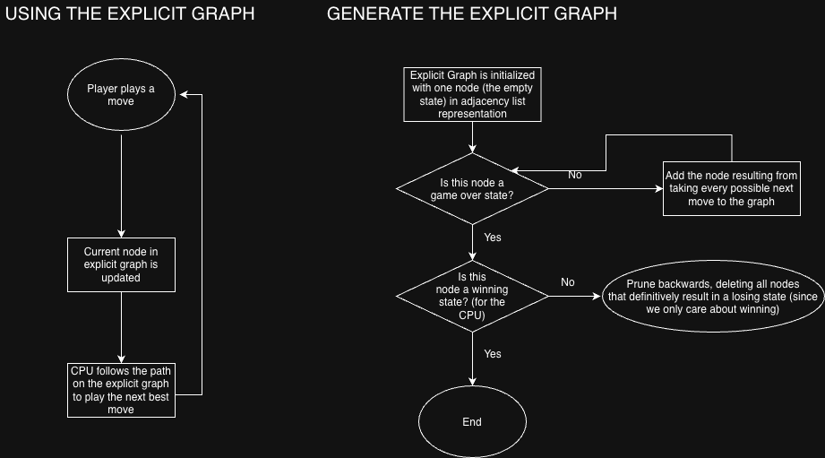

# Project Goal
Find the best tic tac toe strategy. Analyze and generalize it.

# Idea
Explicit graph representation of tic tac toe with each node being a state and each edge being a move.

# Milestones
1. Tic Tac Toe environment (player vs player).
2. Create graph data structure.
3. Build an explicit graph with recursion for tic tac toe.
4. Player vs Computer, computer follows the optimal path on the explicit graph.
5. Visualization of explicit graph.
6. Insights on optimal strategy and optimizing the algorithm used by the computer to determine the next best move.
7. Generalize to larger tic tac toe boards.

# Tech Stack
Language is C.
libc, maybe RayLib if I have time.

[Eisenhower Matrix](The Eisenhower Matrix - CS193 Tic Tac Toe Project.pdf)
